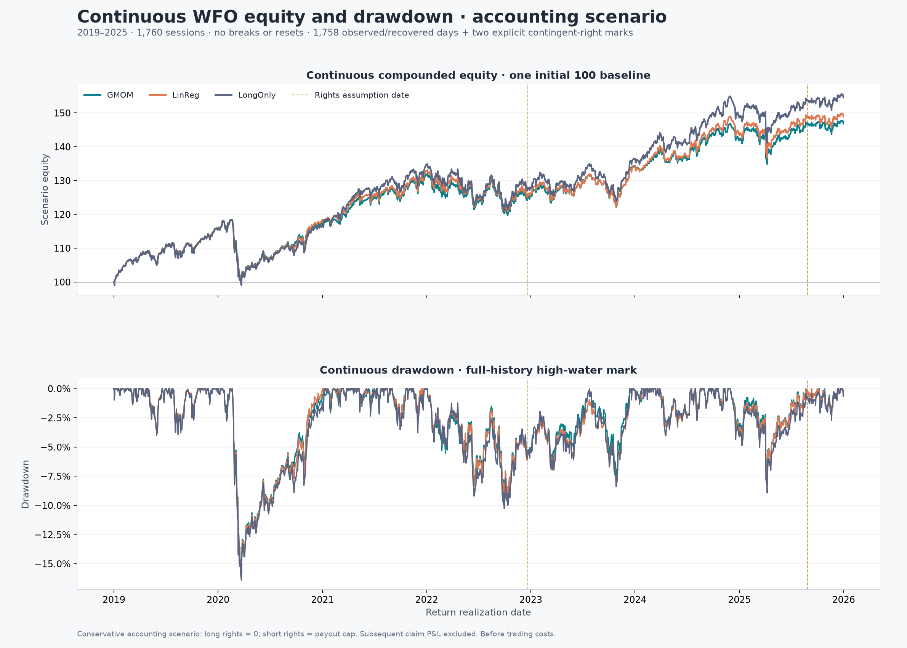
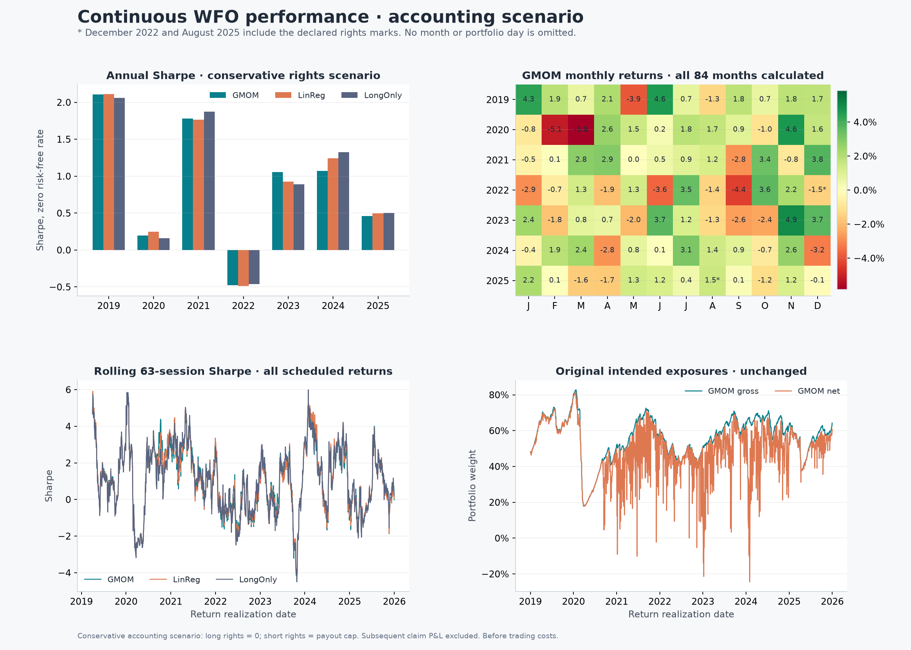

# Continuous WFO equity and performance

**1,760 / 1,760 sessions, 84 / 84 months, one continuous equity path.**
The original forecasts and positions remain frozen. This is a **conservative
contingent-right accounting scenario**: two unavailable market valuations use
explicit assumptions. Cash is recognized; long rights are marked zero and
short rights reserved at their contractual payout cap. Subsequent rights
cash flows, financing, revaluations and reserve releases are excluded.

## Current charts

- [Two-page PDF](performance/performance_charts.pdf)
- [Self-contained HTML report](performance/performance_report.html): download and open locally; GitHub shows HTML source.
- [Definitions, results and limitations](../../docs/CONTINUOUS_WFO_PERFORMANCE.md)

Equity starts at 100 once and compounds every session. Drawdown uses the
full running high-water mark. Dashed lines mark the two assumption dates;
they do not break the curves. Narrow shaded envelopes compare four possible
zero/face event marks, all sharing the exclusion of subsequent claim P&L.
They are not bounds on actual wealth with later rights cash flows.

## Conditional full-period results

| Strategy | CAGR | Maximum drawdown | Sharpe |
| --- | ---: | ---: | ---: |
| GMOM | 5.65% | -16.05% | 0.733 |
| LinReg | 5.87% | -16.18% | 0.746 |
| LongOnly | 6.43% | -16.40% | 0.766 |

All figures are before trading costs and conditional on the rights policy.
LongOnly is the inverse-volatility-sized matched cohort, not an S&P 500 index.
GMOM CAGR across all four event-mark assumptions is 5.6523%–5.6618%.

The two assumptions affect ABMD on 2022-12-22 and WBA on 2025-08-28. GMOM's
portfolio-day returns are -0.03224% and -0.12456%, respectively. Neither
whole portfolio day is zero-filled, dropped or reweighted. All other 1,758
portfolio days and all original intended exposures stay unchanged.

## Tables and evidence

| Output | File |
| --- | --- |
| Complete daily portfolio returns with both assumption dates flagged | [daily_paper_proxy_returns.csv](results/daily_paper_proxy_returns.csv) |
| Continuous equity and full-history drawdown | [equity_drawdown.csv](results/equity_drawdown.csv) |
| All 84 monthly returns | [monthly_returns.csv](results/monthly_returns.csv) |
| Annual/aggregate return, CAGR, volatility, Sharpe, Sortino and Calmar | [paper_proxy_metrics.csv](results/paper_proxy_metrics.csv) |
| Rights and short-reserve register for all six strategies | [claim_register.csv](results/claim_register.csv) |
| Four alternative initial-mark combinations | [claim_mark_scenario_metrics.csv](results/claim_mark_scenario_metrics.csv) |
| Equity sensitivity envelope | [claim_mark_sensitivity_envelope.csv](results/claim_mark_sensitivity_envelope.csv) |
| Exact accounting policy and primary event sources | [policy.json](results/policy.json) |
| Independent holdings/curve/metrics verification | [report.json](verification/report.json) |

The verifier independently derives the 12 assumed strategy/event returns
from original holdings and cash/right terms, preserves every other observed
or recovered day, checks all 504 strategy/month returns and verifies one
uninterrupted path for each strategy. All 75 structural tests pass.

The [earlier valuation audit](../valuation_repaired_wfo/README.md) retains the
two unknown source marks. No raw stock label, feature, model or tradeable
price is fabricated here. No non-transferable right is assumed sold.
This scenario does not supply executable fills, complete later rights cash
flows, trading costs, borrow/financing or a rebuilt clean training dataset.
The large raw data and prediction tables are excluded from this review
export. Viewing the report requires no local raw data; reconstruction does.
