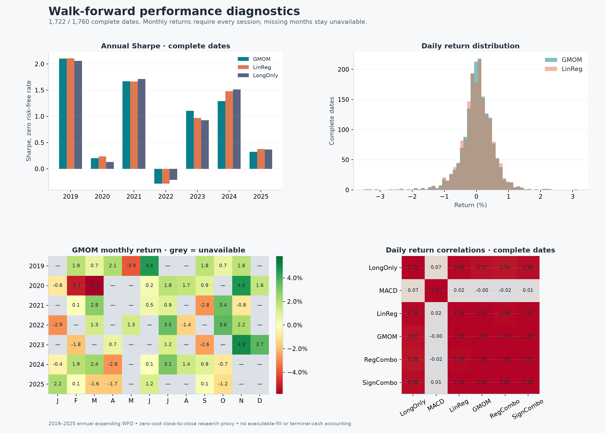
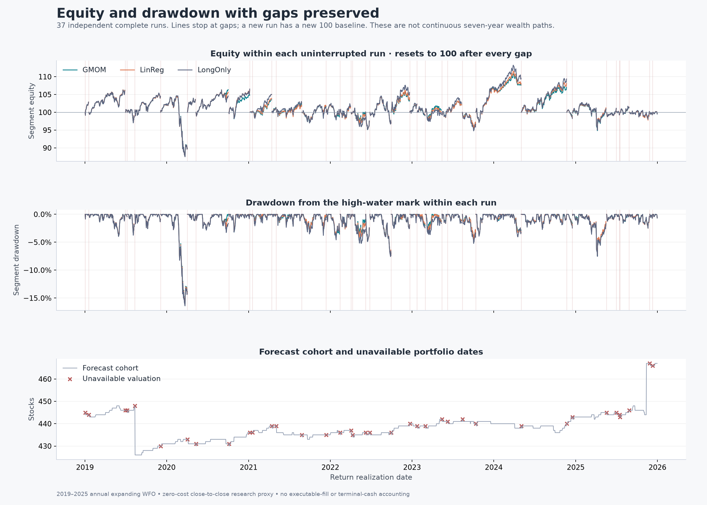

# Original full universe walk forward outputs

These saved outputs cover the original S&P 500 network-momentum experiment:
2016–2018 initial OLS training, expanding annual refits and 2019–2025 test
returns. All eligible PIT members receive a long or short position based on
their forecast sign, sized by asset volatility. There is no top-N selector.
The test holds 426–467 stocks daily, averaging about 439.

## Start here

- [Results and annual comparisons](../../docs/ANNUAL_WALK_FORWARD_RESULTS.md)
- [Additional performance metrics](../../docs/ANNUAL_WALK_FORWARD_PERFORMANCE.md)
- [Four-page chart PDF](performance/performance_charts.pdf)
- [Self-contained HTML report](performance/performance_report.html): download and open locally; GitHub displays HTML source rather than running the report.
- [WFO chronology and methodology](../../docs/ANNUAL_WALK_FORWARD.md)

## Performance overview

## Equity and drawdown

The 38 unavailable portfolio dates remain gaps. Each uninterrupted run starts
from a new 100 baseline; these lines do not represent continuous seven-year
wealth. Full-period CAGR and maximum drawdown remain withheld.

The [longest complete interval](performance/longest_complete_period.png) covers
140 sessions, 2024-05-06 through 2024-11-21. It was selected by continuity only.
The [rolling risk and exposure chart](performance/rolling_risk_and_exposure.png)
requires all 63 daily returns for each rolling statistic.

## Tables and fitted models

| Output | File |
| --- | --- |
| Daily returns, coverage and intended net/gross exposures for all six strategies | [daily_paper_proxy_returns.csv](results/daily_paper_proxy_returns.csv) |
| Annual and aggregate performance | [paper_proxy_metrics.csv](results/paper_proxy_metrics.csv) |
| Sortino, positive-day frequency and tail diagnostics | [extended_metrics.csv](performance/extended_metrics.csv) |
| Monthly returns with incomplete months withheld | [monthly_returns.csv](performance/monthly_returns.csv) |
| Return correlations | [return_correlations.csv](performance/return_correlations.csv) |
| Equity and drawdown within uninterrupted runs | [segment_curves.csv](performance/segment_curves.csv) |
| Every graph-validation candidate score | [validation_scores.csv](results/validation_scores.csv) |
| Annual selected graph parameters | [selected_parameters.csv](results/selected_parameters.csv) |
| Annual model coefficients and feature scalers | [2019](results/models_2019.json), [2020](results/models_2020.json), [2021](results/models_2021.json), [2022](results/models_2022.json), [2023](results/models_2023.json), [2024](results/models_2024.json), [2025](results/models_2025.json) |
| Exact annual fold boundaries | [folds.csv](protocol/folds.csv) |
| Forecast MSE diagnostics | [forecast_metrics.json](results/forecast_metrics.json) |
| Independent full-run numerical verification | [wfo_report.json](verification/wfo_report.json) |

## Interpretation and provenance

The source run contains 771,773 OOS forecasts and 21 fitted OLS models across
1,760 return dates. The verifier independently replayed every forecast and
strategy return. Complete-date GMOM Sharpe is 0.757, compared with 0.774 for
own-stock LinReg. All 63 tests for the original pipeline and reporting pass.

Returns are a zero-cost close-to-close research proxy. They exclude executable
fills, trading costs, borrow/financing and complete terminal/corporate-action
cash flows. PIT membership and chronological fitting do not resolve all source
identity or price-history limitations. LongOnly is an inverse-volatility-sized
matched cohort, not a capital-weighted S&P 500 index.

This folder contains compact review outputs, without raw prices, feature
matrices, daily graph arrays or the approximately 100 MB of stock/date
prediction tables. The original [result manifest](results/manifest.json) and
verification describe the complete local run and reference those omitted
artifacts. Re-running their full verification needs the pinned local dataset;
viewing these tables and charts does not.

The [export manifest](export_manifest.json) records hashes for every copied
artifact. The analysis and chart values are unchanged from the verified run.
