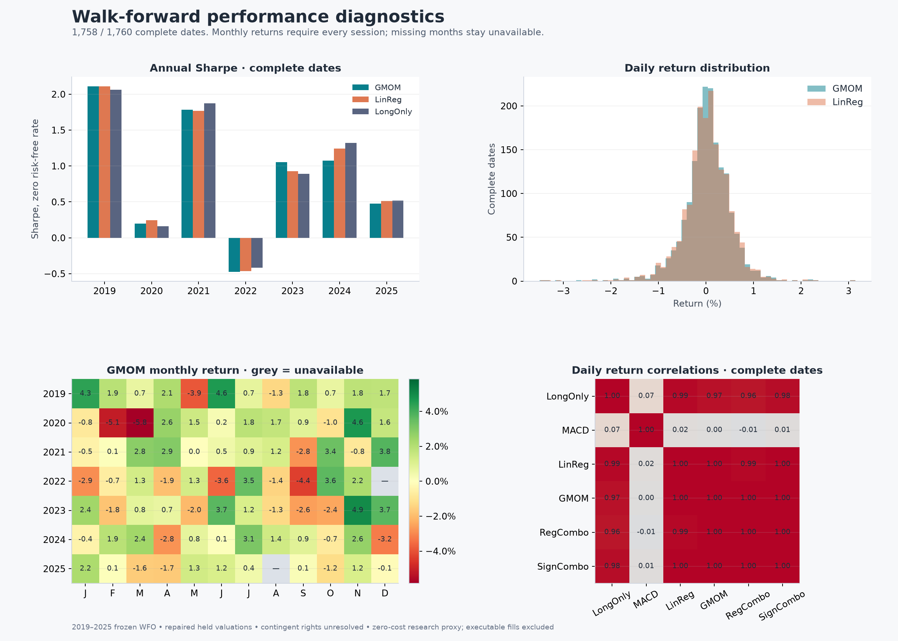
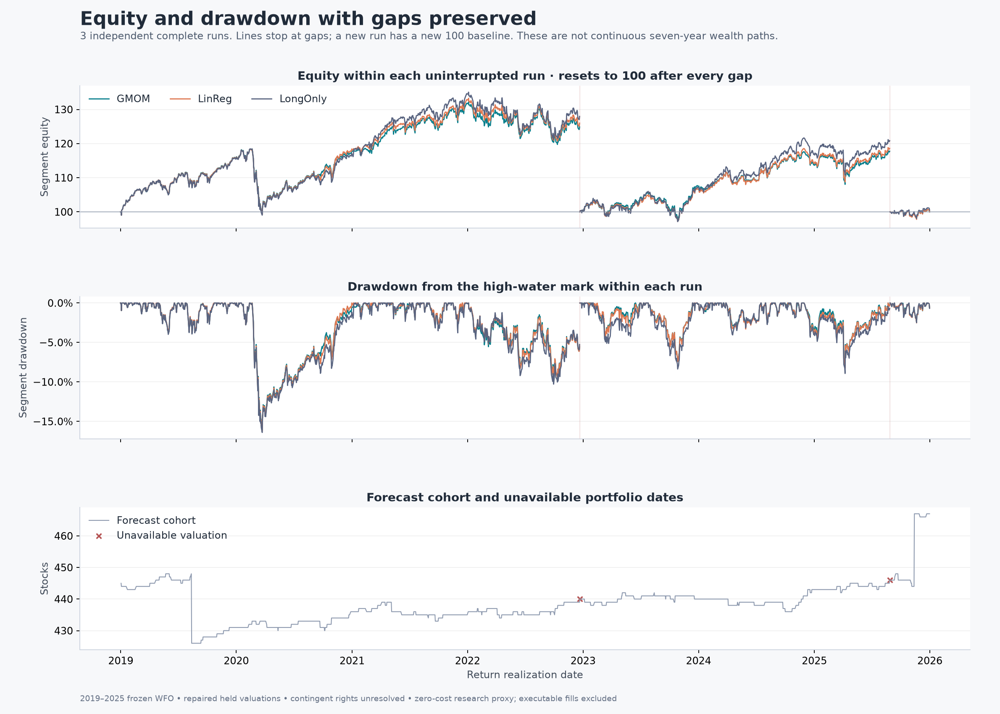

# Repaired held valuations on the original WFO

The original full eligible PIT S&P 500 strategy and every forecast remain
unchanged. This bundle corrects realized valuation gaps only; it has no top-N
selector or ranker.

**60 of 62 missing stock/date outcomes recovered; unavailable portfolio days
fall from 38 to 2; complete months increase from 53/84 to 82/84.**

## Start here

- [Repair explanation, evidence and limits](../../docs/WFO_VALUATION_REPAIRS.md)
- [Four-page chart PDF](performance/performance_charts.pdf)
- [Self-contained HTML report](performance/performance_report.html): download and open locally; GitHub shows HTML source.
- [Detailed performance definitions](../../docs/WFO_VALUATION_REPAIR_PERFORMANCE.md)
- [Unchanged original output bundle](../original_wfo/README.md)

## Remaining gaps and equity interpretation

December 2022 and August 2025 remain incomplete because the ABMD and WBA
mergers included non-tradeable contingent rights. Cash-only or maximum-right
marks are not substituted into primary returns. Their GMOM one-day portfolio
mark ranges are 0.380 and 5.893 basis points, with sign accounted for. These
are hypothetical one-day marks, not a liquidation or carried-rights ledger.

The three complete runs reset independently to 100. The longest spans 1,002
sessions, 2019-01-02 through 2022-12-21. Continuous full-period CAGR and maximum
drawdown are withheld across the remaining two gaps.

## Tables and verification

| Output | File |
| --- | --- |
| Exact corrections and two unresolved keys | [valuation_ledger.csv](results/valuation_ledger.csv) |
| Daily returns and unchanged intended exposures | [daily_paper_proxy_returns.csv](results/daily_paper_proxy_returns.csv) |
| Annual and aggregate moments | [paper_proxy_metrics.csv](results/paper_proxy_metrics.csv) |
| Extra risk and tail metrics | [extended_metrics.csv](performance/extended_metrics.csv) |
| Monthly compounded returns | [monthly_returns.csv](performance/monthly_returns.csv) |
| Six-strategy contingent-right sensitivity | [contingent_claim_sensitivity.csv](results/contingent_claim_sensitivity.csv) |
| Repair policy and limitations | [policy.json](results/policy.json) |
| Independently replayed portfolio sums | [valuation_report.json](verification/valuation_report.json) |
| Source-evidence reconstruction check | [evidence_reconstruction.json](verification/evidence_reconstruction.json) |
| Primary merger references and final terms | [valuation_events_v1.json](evidence/valuation_events_v1.json) |
| Three reviewed predecessor quote transcriptions | [valuation_manual_quotes_v1.json](evidence/valuation_manual_quotes_v1.json) |

GMOM complete-date Sharpe is 0.736, LinReg 0.753 and matched LongOnly 0.776,
before costs. They now use 1,758 dates, versus 1,722 originally; all previously
observed returns remain unchanged. The verifier replayed every strategy/date
sum and checked original-artifact hashes. All 69 structural tests pass.

This retrospective outcome correction does not rebuild feature histories,
refit networks or OLS, or change validation selection or the forecast cohort.
It does not certify executable trading, original historical identities,
complete training data, settlement cash timing, or subsequent rights payouts.
Large raw/source objects, feature matrices and stock/date forecast Parquets
are omitted. The export manifest lists every copied file's checksum.
