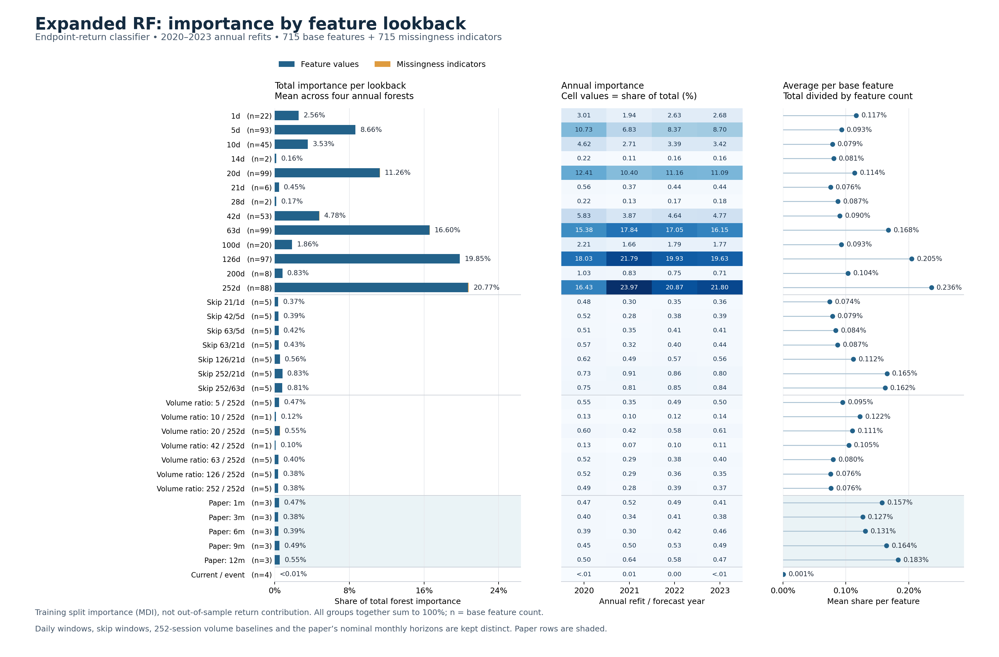

# Expanded RF importance by feature lookback — 22 October 2026

This descriptive analysis reloads the four saved **endpoint-return RF models**
from the latest fixed-RF unstopped-target comparison, one annual model for
2020–2023. They use the paired completed training mask and shared annual
training-only preprocessor of that experiment, not an older archived RF run.
The separately trained cash/utility long/short heads are outside this figure.
Stops operate in daily execution and do not change the fitted endpoint forest.

[PDF](assets/rf_importance_by_lookback_20261022.pdf)

## Meaning and grouping

These are sklearn **mean decrease in impurity (MDI)** importances: normalized
reductions in training-node Gini impurity. Four annual forests receive equal
weight; the annual heatmap shows each separately. They are not out-of-sample
accuracy gains, signed effects, class-specific payoffs or portfolio-return
contributions. Different annual parameters and overlapping ten-year training
windows mean the four observations are not independent uncertainty estimates.
Correlated indicators can share importance, and MDI favors features with more
split opportunities. See the official [forest importance example](https://scikit-learn.org/stable/auto_examples/ensemble/plot_forest_importances.html)
and [correlated feature example](https://scikit-learn.org/stable/auto_examples/inspection/plot_permutation_importance_multicollinear.html).

The feature bank has different month-end **lookback windows**, not a uniform
vector of shifted monthly prediction lags. All 715 base features are assigned
exactly once to 33 groups. Ordinary session windows contain 634 features;
35 skip-return and 27 abnormal-volume features stay in separate composite
groups; the paper contributes 15 monthly features; four current/event features
have their own group. Paper monthly horizons are not converted to trading days.
The paper's nominal3/6/9/12-month features compound2/5/8/11 monthly returns and
skip the latest return month; nominal1 uses the current month's return.

A declared20-session return window needs21 closes; autocorrelation may need an
additional observation. Abnormal volume combines an outer window and a252-session
baseline (up to503 required raw observations). The mapping preserves registered
raw history spans separately from its intuitive nominal window label. It does
not assign composites to a short-only bin or double-count a feature in several
bins. Cross-sectional transforms inherit the native feature's window.

Each model has715 feature-value columns interleaved with715 missing indicators.
The saved preprocessing manifest determines exact model column order. Values
and missingness retain their original global shares rather than being separately
renormalized. Every one of the715 base features is retained in all four models.
Groups sum to100% per year. The right panel divides each group's share by its
number of base features, avoiding a direct comparison based only on group size.

## Measured summary

| Declared window | Features | Mean total importance | Mean per feature |
|---|---:|---:|---:|
| 252 sessions | 88 | 20.77% | 0.236% |
| 126 sessions | 97 | 19.85% | 0.205% |
| 63 sessions | 99 | 16.60% | 0.168% |
| 20 sessions | 99 | 11.26% | 0.114% |
| 5 sessions | 93 | 8.66% | 0.093% |
| 42 sessions | 53 | 4.78% | 0.090% |
| 10 sessions | 45 | 3.53% | 0.079% |
| 1 session | 22 | 2.56% | 0.117% |

The252/126/63-session groups jointly account for **57.22%** of the four-model mean.
The252-session group is also largest after dividing by feature count. This is
observed split usage, not a decision to remove short windows or Paper15.
Missingness indicators account for0.472%,0.178%,0.053% and0.065% in2020–2023,
respectively (0.192% equal-year mean).

## Evidence, resources and reuse

Before deserialization, a metadata-only plan authenticated the existing20-fit /
four-preprocessor independent PASS and exact model/preprocessor artifact pins.
The four endpoint models total214,799,748 bytes, under a512MiB read cap. They were
loaded sequentially: four500-tree forests, classes1–10,715+715 columns, saved
inference n_jobs1 and exact annual RF parameters. Extraction took1.94seconds
with496,336,896bytes peak process RAM. It performed **zero fits, predictions,
feature/price-panel reads or daily replays**. Financial2024+ values were not read.

The source modules are `rf_importance.py` (explicit planned model-only extraction),
`importance_horizons.py` (pure exhaustive metadata mapping), and
`importance_reporting.py` (conserving aggregation, rendering and passive reader).
The tests cover interleaved mappings, fingerprint/pin guards, null dropped-column
semantics, composite-window definitions, group conservation and artifact integrity.
A separate metadata/derived-only review exactly reproduced all group summaries.
This is a plot audit, not a new certification of historical source data.

The ignored local report is
`outputs/feature_importance/endpoint-2020-2023-20261022-v1/`. It includes raw
per-feature importances, the715-name mapping with full dependency metadata,
33-group annual/mean tables, original extraction evidence and figure files.
The outer plot receipt authenticates byte-exact relative copies; copied inner
receipts retain their original staging paths and bytes. No raw data or models
are published. Figure rendering used the existing host Conda matplotlib; model
loading used the research virtualenv and its exact saved sklearn runtime.

Master section31 calls `read_importance_plot` and displays the saved PNG only.
It imports no model loader and starts no extraction, fit, prediction, price scan
or backtest. A fresh clone displays the original aggregate figure in this note
but lacks private model/report files. The known deferred execution cases remain
deferred; no cohort, target, selection, stop, cost, run or active pointer changed.
