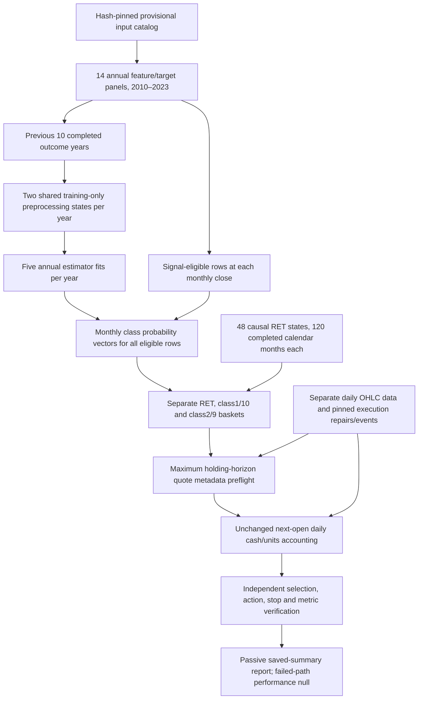

# Corrected-input research data flow

The frozen 2020–2023 outer years use 2010–2019, 2011–2020, 2012–2021 and 2013–2022 training outcomes respectively. Four baseline arms are RF/XGBoost × Paper15/expanded715. The fifth arm reuses the prior annual CV settings for RF expanded; it is not a fresh tuning search. There are20 fits and8 preprocessing states. The source annual panels already contain causal feature snapshots under the existing80% policy; the refit adds only training-window-fitted preprocessing.

Observed completed training targets determine training rows. At prediction time, eligibility does not depend on the future target being observed, and all five arms use the same eligible prediction keys. Prediction diagnostics score only observed labels while retaining all eligible rows in the coverage denominator. No 2024+ financial evaluation is performed.

RET uses the entire probability vector against the frozen historical class-mean payoff vector. Class1/10 and2/9 selection are separate alternatives. Quote metadata/preflight cannot remove a selected position. Selection shortages use the same available count on both sides, up to10, with50%/50% allocations. A stop variant changes actual holding duration, so maximum-horizon coverage is diagnostic rather than an automatic declaration of failure.

The monthly label is provider-adjusted close-to-close return; execution begins at the next session's open, and stops change realized payoffs. They are different economic quantities. This run preserves that definition and does not claim exact label/execution payoff equality. Daily data remains separate for feature calculations and execution; no monthly OHLC aggregation substitutes for daily stops/accounting.

Independent checks verify the saved computation and timing within the frozen scope. Provisional historical identity routes, provider adjustment vintage, terminal-event evidence and survivorship/knowledge-time limitations remain. New selected-horizon gaps are documented in SELECTED_HORIZON_GAPS_20261021.md. Failed paths keep their holdings/exposure, and their full-period and annual performance remains unavailable. Source acceptance is not inferred from an attractive return.
